## 理解均轮本轮拟合图形的原理

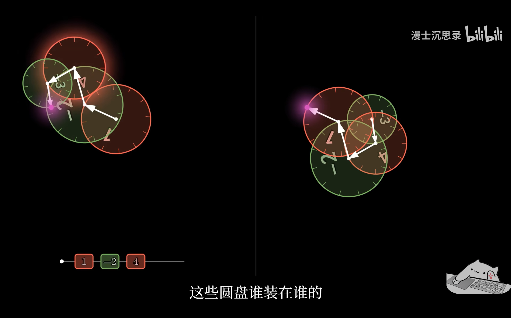

首先明确一点，对于选定的圆盘，组装顺序并不会影响最终绘制的图形。这是因为从向量合成角度看，向量满足交换律，向量叠加的顺序不会影响最终合向量结果

现在来归纳下我们的问题：如何确定这些不同转速的圆盘的**半径**与**初始角度**

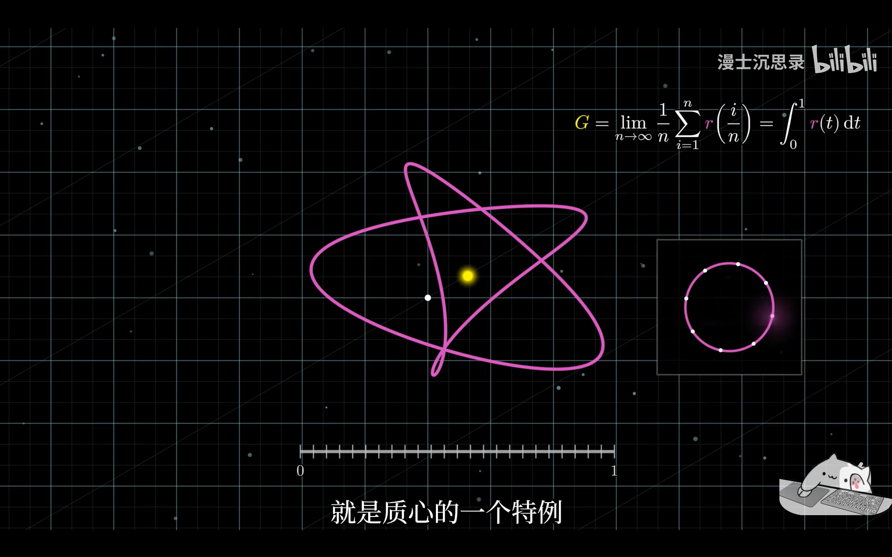

如果我们以一定的方式组合这些圆盘，如图所示，黄点表示第一个圆盘，我们断言 **第一个圆盘的圆心位于所绘图形的质心**

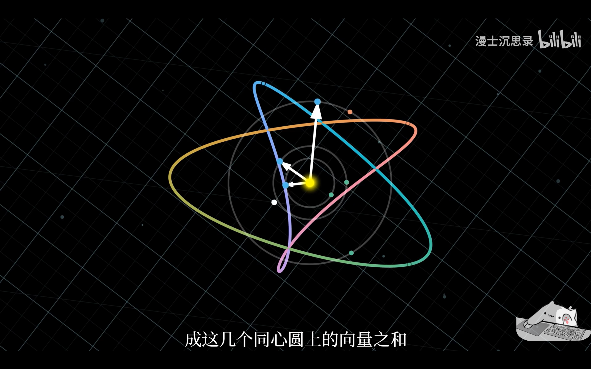

这个结果仔细想想还是蛮符合直觉的，可以用如下方式来严格论述：

考虑所绘图形上任意一点，如图左上角所示的蓝点，它由三个向量叠加得到，我们拿到这三个分向量，并在同心圆上标出它们的终点，如图所示的三个蓝点。

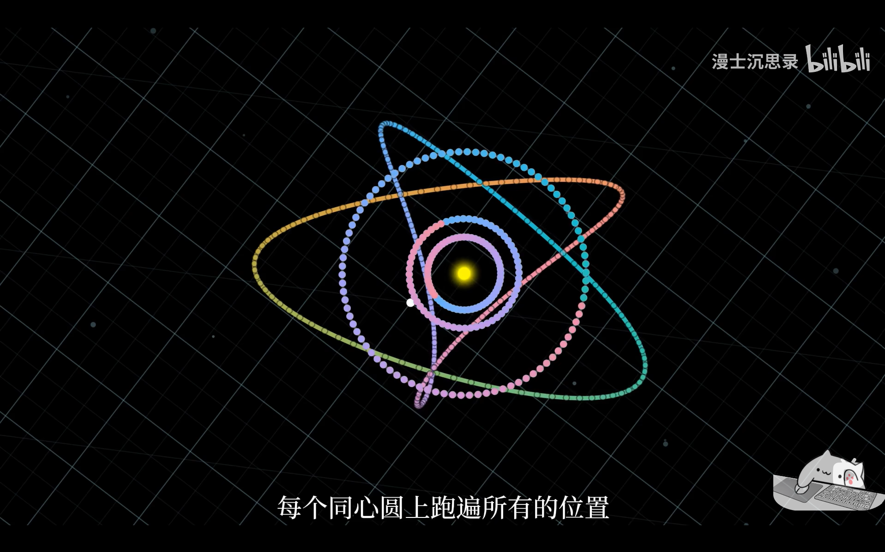

已知的是当最外圈的圆盘完整绘制该图形后，所有圆盘必定转整数圈，所以当我们以极短的时间间隔在图形上密集的取点，再分解到同心圆上，那么这些点一定跑遍所有同心圆。将所绘图形上的点求平均，就是在对同心圆上的点求平均(因为向量分解)。因此对这些同心圆上的点求质心，就是对所绘图形求质心，就是同心圆的圆心

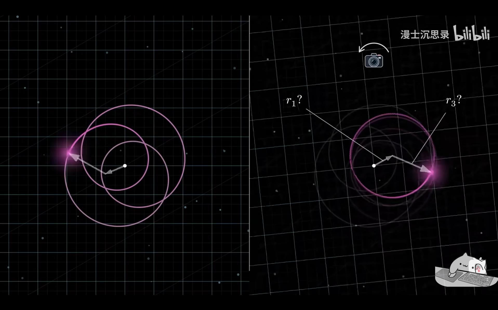

好的我们现在能确定第一个圆盘的位置，它位于所绘图形的质心，但这还不足以达成我们的目标。考虑这样一幅图景：让我们的视角随最里面那个圆盘一同旋转，也就是说把第一个圆盘的终点当作圆心，关注最外面那个向量的运动图形。比如上图所示的只有两个圆盘叠加得到左侧的图案，然后把视角随第一个图形一样旋转，得到新的轨迹，它就是圆盘本身！所以用同样的方法我们可知，第二个圆盘的圆心或者说最里面那个向量的终点，就是新轨迹的质心！

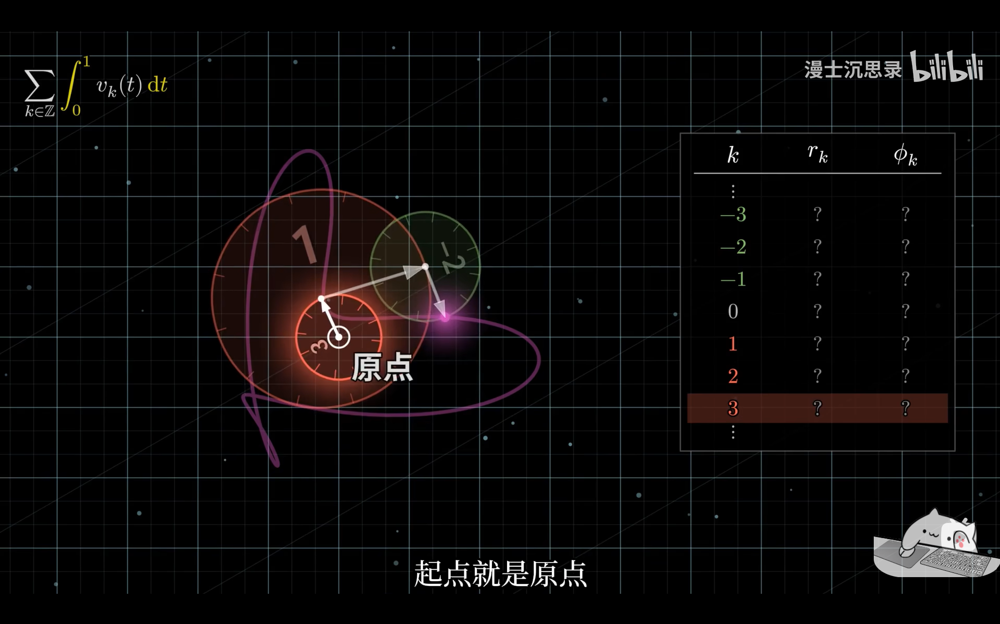

接下来要做的事就很简单了，如果我要确定第 $k$ 个圆盘的参数 $r_k,\phi_k$，那就只需要把第 $k$ 的圆盘放在最里面

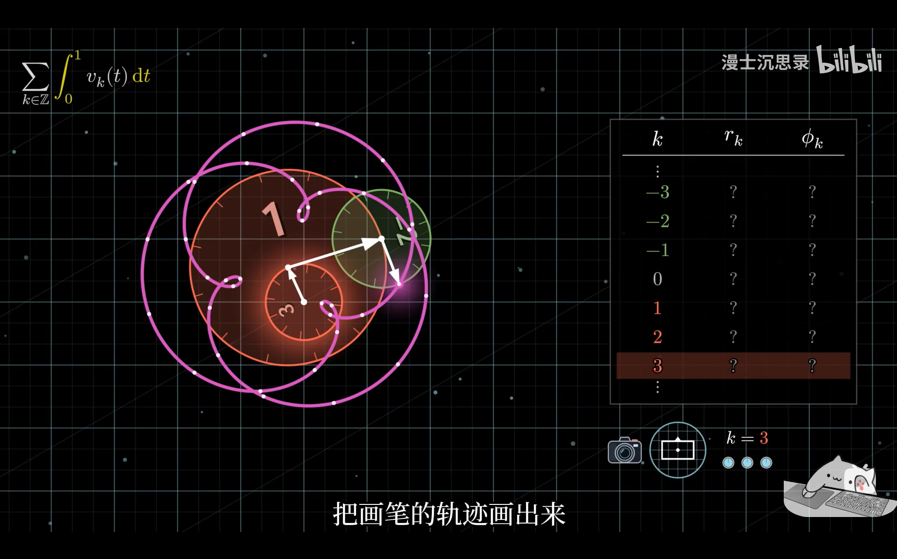

画出在第 $k$ 个圆盘视角下的新图形，求这个图形的质心，就能得到所需的 $r_k,\phi_k$。将所有圆盘按这种方式操作一遍，就能得到所有所需的参数了

问题到这似乎解决了，吗？如果你有仔细思考，会注意到前面我们有意避开了一个问题，那就是**我怎么知道第 $k$ 个圆盘视角下的图形究竟是什么？** 所以接下来我们的目标就是：刻画这种变换

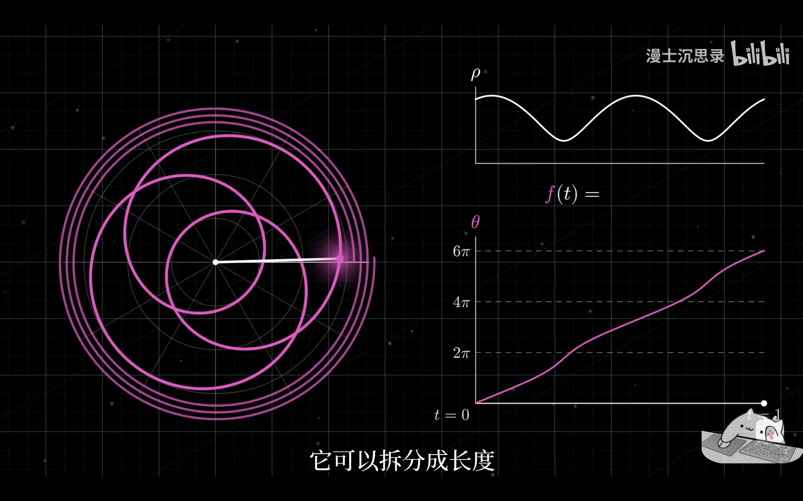

首先定义一些参数，还是考虑上面提到过的那个仅由两个圆盘叠加得到的图形；假设图形质心就在原点；假设绘制周期为1；我们用极坐标表示图案

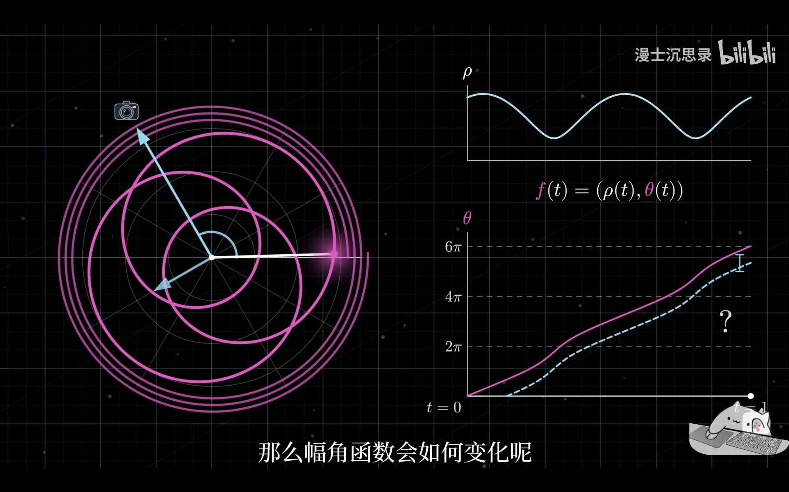

用极坐标能很好的刻画这种变换，因为当我们的视角随着最里面的圆盘转动时，画笔的位置没有变，即 $\rho(t)$ 不会变，变的只有 $\theta(t)$

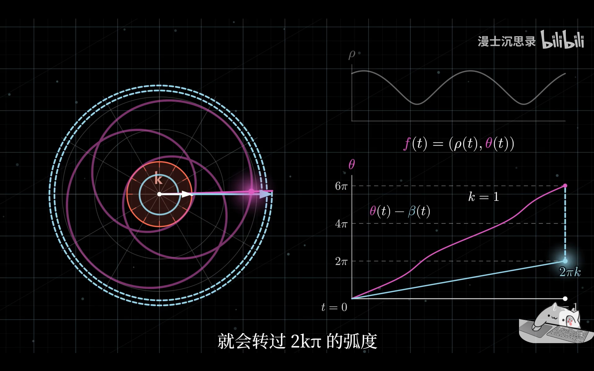

那么 $\theta(t)$ 是怎么变的呢，很简单就是个追及问题。原来的图形对应 $\theta(t)$，观察视角改变后，变为了 $\theta(t)-\beta(t)$，$\beta(t)$ 就表示视角的旋转。假设我们是站在第 $k$ 个圆盘的视角下观察(单位时间转 $k$ 圈)，那么 $\beta(t)=2k\pi t$

如此我们便能得到变换后的图案
$$
\left\{ \begin{array}{l}
	\rho \left( t \right)\\
	\theta \left( t \right) -2k\pi t\\
\end{array} \right. 
$$
 其中 $k$​ 取决于视角旋转有多快

## 与 $Fourier$ 变换的关系

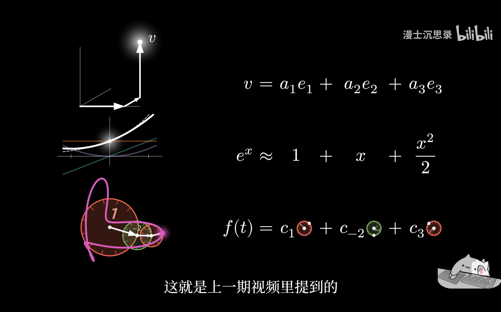

以泛函的视角看，本轮和均轮构成了一组基(每个基向量表示一种匀速圆周运动)，用这些基向量可以拟合曲线 $f(t)$，那么这些基向量从数学的角度看究竟是什么呢

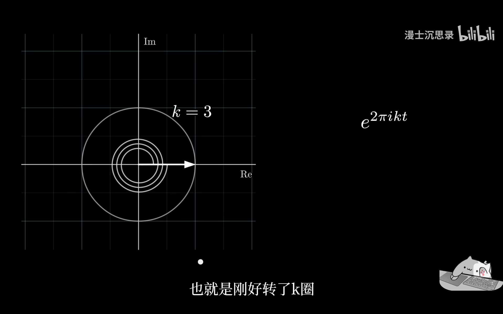

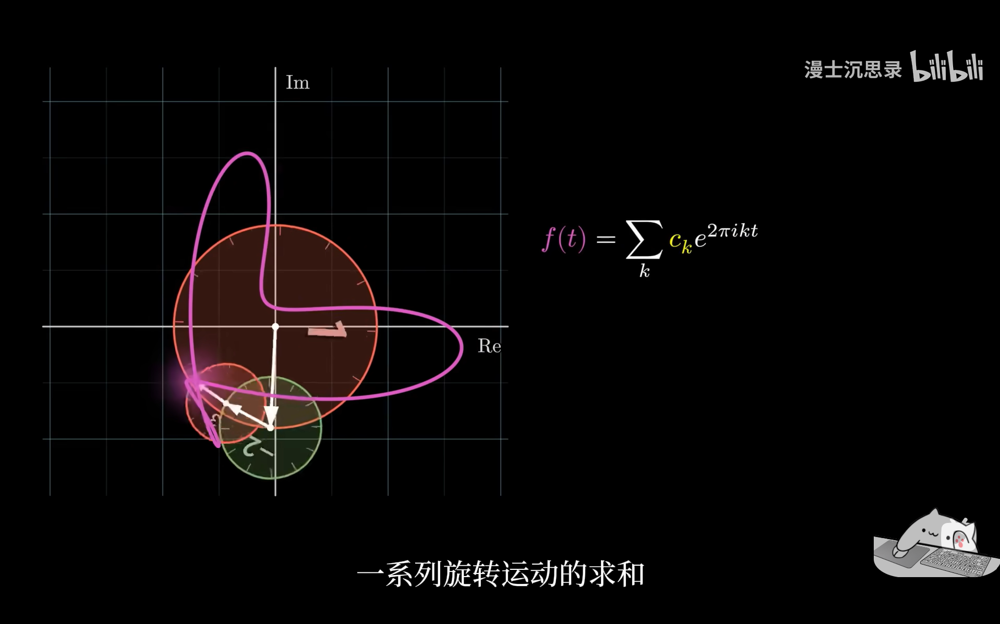

毫无疑问，描述二维旋转最优雅的方式就是 **复指数函数** ，所以那些圆盘正是标准正交基 $\{e^{2k\pi i}\}_{k=1}^{\infty}$​

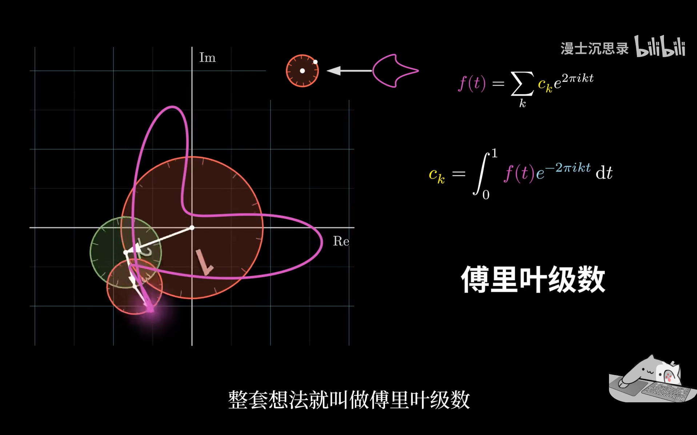

上节那套用一系列匀速旋转的圆盘拟合曲线的方式，本质上就是将曲线在这组标准正交基下做分解，而系数 $\{c_k\}_{k=1}^{\infty}$，自然就是曲线 $f(t)$​ 与 基向量分别做内积，**这正是 $Fourier$ 变换**  

并且和上一节的分析是一致的，因为 $f(t)$ 乘以 $e^{-2k\pi i}$ 就是在求变换后的图形 (把幅角减去 $2k\pi$)，而对变换后的曲线积分就是在求质心

